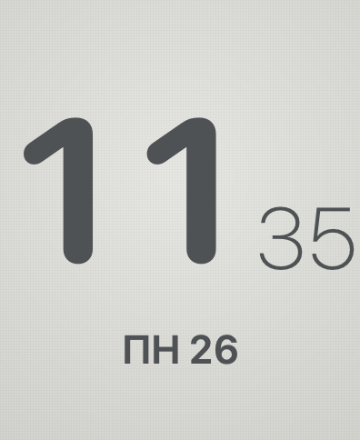
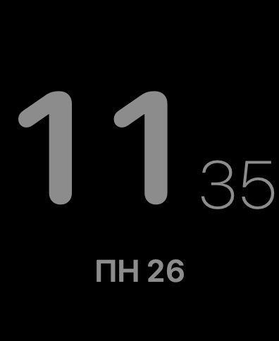

# E-ink — «бумажный» циферблат для Apple Watch

*E-ink style watch face for Apple Watch, built with SwiftUI + WidgetKit.*

<p>
  
  
</p>

Свои циферблаты Apple ставить не даёт, поэтому стиль e-ink собран из штатных средств watchOS:

1. **Приложение E-ink** — полноэкранный вид как у e-ink часов: крупный скруглённый час,
   тонкие минуты, погода и день недели. В Always-On экран становится чёрным с серыми цифрами.
2. **Виджет «E-ink время»** — тот же стиль в слотах штатных циферблатов
   (прямоугольный, круглый, угловой, строка).

## Как это устроено
- `Watch/FaceView.swift` — экран: `TimelineView(.everyMinute)`, размеры от ширины экрана,
  `isLuminanceReduced` для Always-On.
- `Shared/EinkStyle.swift` — палитра, форматы времени и текстура e-ink на `Canvas`.
- `Watch/Weather.swift` — погода с [Open-Meteo](https://open-meteo.com) (без ключа) по геопозиции, коды WMO → SF Symbols.
- `WatchWidget/EinkWidget.swift` — WidgetKit-расширение с поминутной лентой записей.
- iPhone-приложение — только контейнер для установки на часы.

## Сборка
Нужны Xcode и [XcodeGen](https://github.com/yonaskolb/XcodeGen). Свои команду и префикс bundle id
положи в `Local.xcconfig` (он в `.gitignore`):
```
printf 'DEVELOPMENT_TEAM = <ID команды>\nBUNDLE_PREFIX = com.<твой-префикс>\n' > Local.xcconfig
xcodegen generate
xcodebuild -project EinkFace.xcodeproj -scheme EinkFace -destination 'id=<UDID iPhone>' -derivedDataPath build -allowProvisioningUpdates build
xcrun devicectl device install app --device <UDID iPhone> build/Build/Products/Debug-iphoneos/EinkFace.app
xcrun devicectl device install app --device <UDID часов> build/Build/Products/Debug-iphoneos/EinkFace.app/Watch/EinkFaceWatch.app
```
С бесплатным Apple ID подпись живёт 7 дней — потом пересобрать и поставить заново.

## Чтобы E-ink был вместо циферблата
iPhone → Watch → Основные → Возврат к циферблату → E-ink → «Вернуться к приложению».

## Лицензия
MIT
